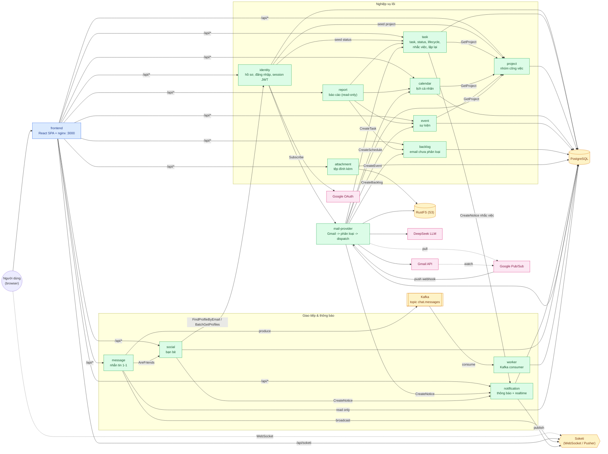
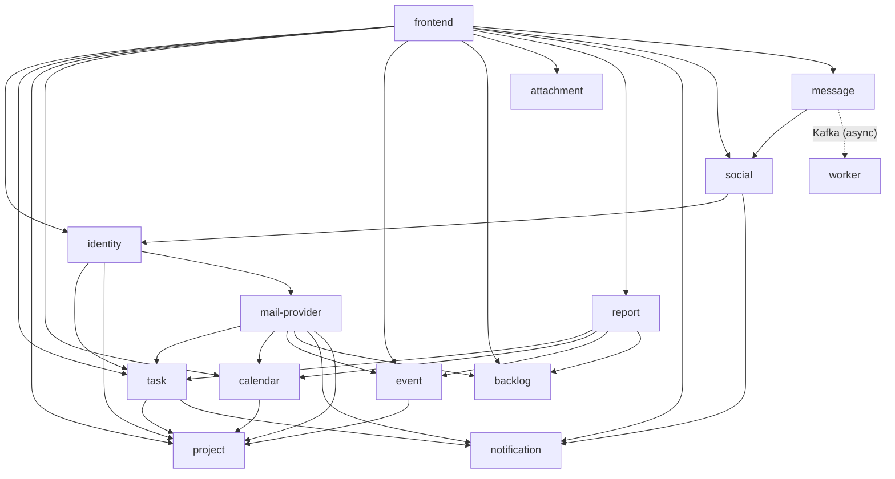
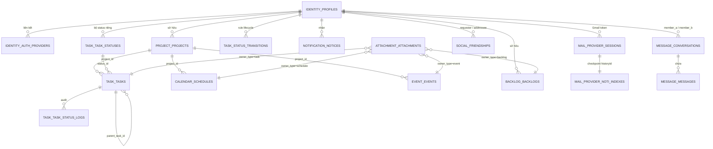
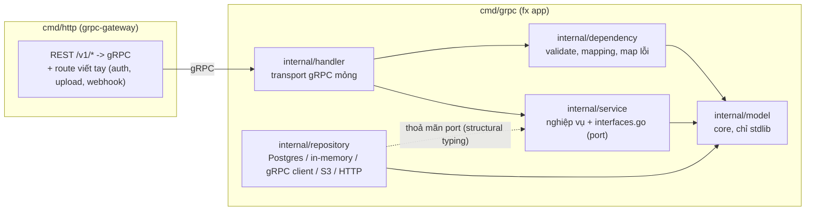

# 01 — Graph các thành phần dự án

> Tài liệu tổng hợp từ việc quét mã nguồn (`service/*`, `common/proto`, `frontend/src`,
> `deployments/`). Mọi sơ đồ dùng **Mermaid** — mở bằng VS Code (extension *Markdown Preview
> Mermaid Support*), GitHub, hoặc dán vào <https://mermaid.live>.
>
> Chi tiết "service nào gọi service nào, bằng API nào, dùng DB gì" xem
> [05-service-calls-and-data.md](05-service-calls-and-data.md).

## 1. Bức tranh tổng thể

Hệ thống **Task Manager** là một monorepo gồm:

| Nhóm | Thành phần | Ghi chú |
|---|---|---|
| Frontend | `frontend/` (React + TS + Mantine + Vite, chạy sau nginx) | Entry point duy nhất publish ra host (`:3000`) |
| Backend (Go, 13 service) | `identity`, `task`, `project`, `calendar`, `event`, `backlog`, `attachment`, `report`, `notification`, `mail-provider`, `social`, `message`, `worker` | Mỗi service = 1 Go module, thường có 2 binary: `cmd/grpc` + `cmd/http` (grpc-gateway) |
| Shared | `common/` (proto, code gen, bộ mã lỗi chuẩn) | `common/proto/<svc>/v1/*.proto` là interface duy nhất giữa các service |
| Hạ tầng | PostgreSQL, Kafka, Soketi, RustFS (S3), Cloudflared | Định nghĩa trong `deployments/docker/docker-compose.yml` |
| Bên ngoài | Google OAuth, Gmail API, Google Pub/Sub, DeepSeek LLM | Chỉ `identity` và `mail-provider` gọi ra ngoài |

> **Không có Redis** trong dự án. Mọi trạng thái bền vững nằm ở PostgreSQL (mỗi service 1 schema),
> nội dung file nằm ở RustFS (S3), luồng sự kiện nằm ở Kafka. Cache/queue tạm nằm trong RAM của
> process (vd queue notice của `mail-provider`).

## 2. Graph thành phần (toàn hệ thống)

## 3. Graph phụ thuộc theo tầng (ai phụ thuộc ai)

Mũi tên `A --> B` = **A cần B** để hoạt động đầy đủ. Service càng ở dưới càng "gốc".

Nhận xét:

- **`project`** và **`backlog`**, **`attachment`**, **`notification`** là service "lá" ở tầng gRPC
  (không gọi service nội bộ nào khác; `notification` chỉ gọi Soketi).
- **`identity` ↔ `mail-provider`** là phụ thuộc hai chiều về mặt luồng nghiệp vụ
  (identity gọi `Subscribe`; mail-provider không gọi lại identity mà chỉ dùng token được truyền sang).
- **`report`** không có DB — chỉ tổng hợp qua gRPC.
- **`worker`** không có API — chỉ consume Kafka và ghi Postgres.

## 4. Chức năng từng thành phần

### 4.1 `frontend`

| Trang (route) | Chức năng | Service gọi |
|---|---|---|
| `/login`, `/auth/callback` | Đăng nhập Google, tuỳ chọn "Cho phép đọc Gmail" | identity |
| `/` (Board) | Kanban/Table/List/Timeline task, kéo thả đổi status, chi tiết task, task con, đính kèm | task, project, attachment |
| `/today` (Agenda) | Việc cần làm hôm nay / quá hạn / sắp tới, đổi status nhanh | task, project |
| `/projects` | Quản lý project (tạo, đổi tên, archive/unarchive) | project |
| `/calendar` | Lịch FullCalendar, CRUD lịch | calendar, attachment |
| `/events` | Bảng CRUD sự kiện | event, attachment |
| `/backlog` | Email chưa phân loại, triage | backlog, attachment |
| `/reports` | Thẻ tổng quan, donut status, line chart, hoạt động | report |
| `/friends` | Tìm bạn theo email, lời mời kết bạn | social |
| `/messages`, `/messages/:peerId` | Chat 1-1 realtime | message, soketi |
| `/statuses` | Status & lifecycle (đã ẩn khỏi menu) | task |
| Topbar | Chuông thông báo, badge chưa đọc, realtime | notification, soketi, identity (`/v1/auth/soketi`) |

### 4.2 Backend services

| Service | Port gRPC / HTTP | Chức năng chính | Lưu trữ |
|---|---|---|---|
| **identity** | 9081 / 8081 | Hồ sơ (profile), liên kết provider, OAuth Google, phát **session JWT HS256**, ký uỷ quyền kênh Soketi, seed dữ liệu mặc định cho profile mới | PG `identity.profiles`, `identity.auth_providers` |
| **project** | 9090 / 8090 | Project theo profile; project mặc định `Chung` (không archive được); archive/unarchive | PG `project.projects` |
| **task** | 9082 / 8082 | Task cha/con, status theo profile, lifecycle allowlist, audit log, tìm kiếm (trigram), **nhắc việc** (worker nền), **task lặp lại** (RRULE) | PG `task.tasks`, `task.task_statuses`, `task.status_transitions`, `task.task_status_logs` |
| **calendar** | 9083 / 8083 | Lịch cá nhân (khối thời gian, all-day, màu) | PG `calendar.schedules` |
| **event** | 9085 / 8085 | Sự kiện có vòng đời `PLANNED → CONFIRMED → CANCELLED`, truy vết email nguồn | PG `event.events` |
| **backlog** | 9086 / 8086 | Email không phân loại được (`NEW/TRIAGED/ARCHIVED`) | PG `backlog.backlogs` |
| **attachment** | 9089 / 8089 | Tệp đính kèm đa hình `(owner_type, owner_id)`; upload multipart / download | PG `attachment.attachments` + S3 |
| **report** | 9087 / 8087 | Báo cáo tổng quan, status breakdown, time series, activity | Không có DB (gRPC) |
| **notification** | 9088 / 8088 | Lưu notice, đếm chưa đọc, đánh dấu đã đọc, push realtime | PG `notification.notices` + Soketi |
| **mail-provider** | 9084 / 8084 | Watch Gmail, nhận Pub/Sub, lưu email gốc S3, phân loại (DeepSeek / keyword), dispatch | PG `mail_provider.sessions`, `mail_provider.noti_indexes` + S3 |
| **social** | 9091 / 8091 | Kết bạn: tìm theo email, gửi/chấp nhận/từ chối/huỷ lời mời, huỷ kết bạn | PG `social.friendships` |
| **message** | 9092 / 8092 | Chat 1-1 giữa bạn bè: broadcast realtime + đẩy Kafka; đọc lịch sử | PG `message.*` (chỉ đọc) + Kafka + Soketi |
| **worker** | — / health 8094 | Consume `chat.messages`, ghi tin nhắn idempotent | PG `message.conversations`, `message.messages` |

### 4.3 Hạ tầng

| Thành phần | Dùng bởi | Vai trò |
|---|---|---|
| **PostgreSQL** `postgres:5432` (DB `task_manager`) | 11 service (trừ `report`; `message` chỉ đọc) | Mỗi service sở hữu 1 schema riêng |
| **migrate** | job khởi động | Chạy `deployments/migrations/*.sql` |
| **RustFS** `rustfs:9000` | `attachment`, `mail-provider` | Object storage S3-compatible, bucket `task-manager` |
| **Kafka** `kafka:9092` (`kafka-init` tạo topic) | `message` (producer), `worker` (consumer) | Topic `chat.messages`, 6 partition, key = `conversation_id` |
| **Soketi** `soketi:6001` | `notification`, `message` (publish REST); browser (WS) | Realtime theo giao thức Pusher |
| **Cloudflared** (profile `tunnel`) | — | Public HTTPS cho webhook Pub/Sub |

## 5. Liên hệ dữ liệu (khoá logic giữa các schema)

`profile_id` (uuid từ `identity.profiles`) là khoá xuyên suốt. Vì mọi schema nằm chung 1
database, migration **có khai báo FK chéo schema**:

- Hầu hết bảng có `profile_id REFERENCES identity.profiles(id) ON DELETE CASCADE` (xoá profile ⇒ xoá
  dữ liệu của profile đó ở mọi schema). Riêng `social.friendships` (`requester_id`, `addressee_id`)
  và `message.conversations` (`member_a`, `member_b`) tham chiếu 2 profile.
- `task.tasks`, `calendar.schedules`, `event.events` có FK `(project_id, profile_id) REFERENCES
  project.projects(id, profile_id) ON DELETE RESTRICT`.
- Ngoài FK, các service vẫn kiểm tra nghiệp vụ qua gRPC trước khi ghi (vd `task`/`calendar`/`event`
  gọi `project.GetProject` để chặn project đã archive hoặc của profile khác).
- `attachment.attachments (owner_type, owner_id)` là liên kết **đa hình**, không có FK tới đối tượng sở hữu.

## 6. Cấu trúc bên trong 1 service (giống nhau cho mọi service)

Quy tắc kiến trúc được kiểm tra tự động bằng `make quality-arch` (`quality.json`):
hướng phụ thuộc, `model` là core, tầng phẳng, bắt buộc `service/interfaces.go`, `cmd` dùng `fx`.
