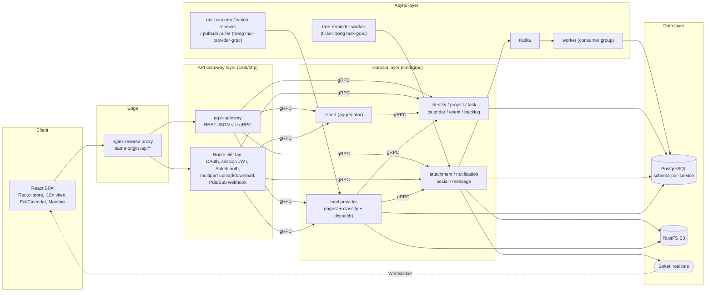
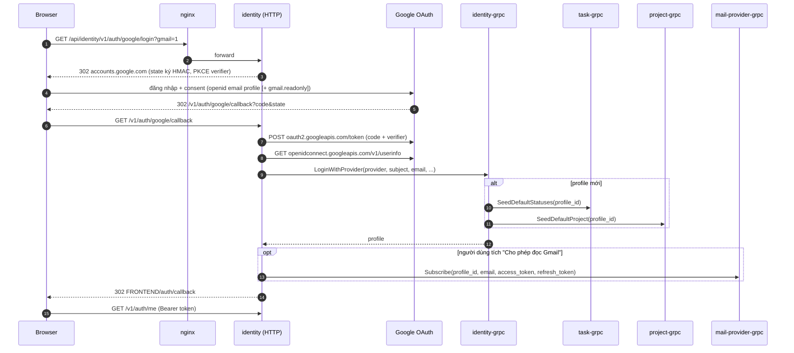
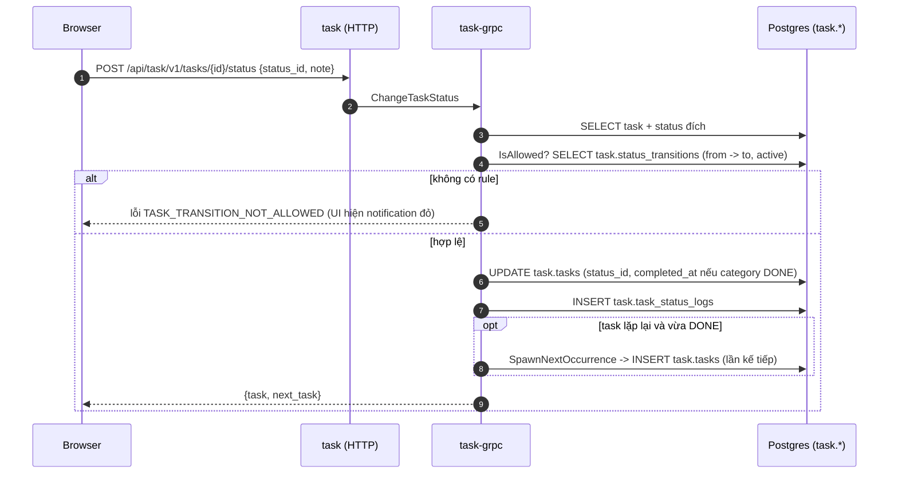
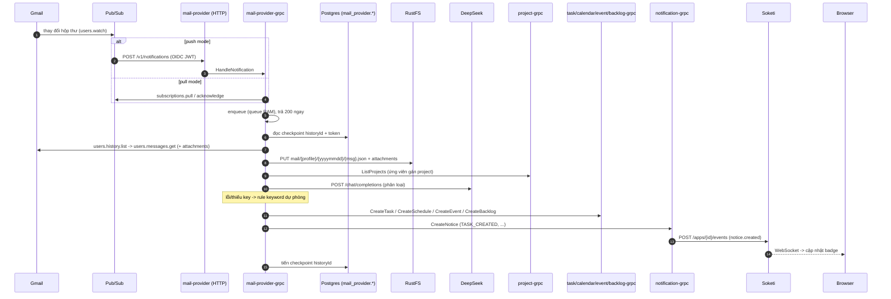
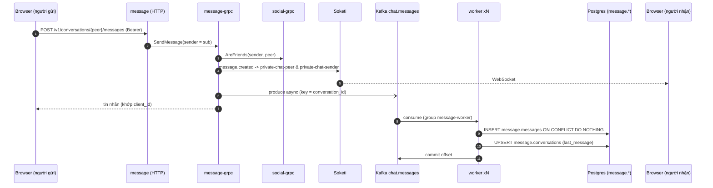
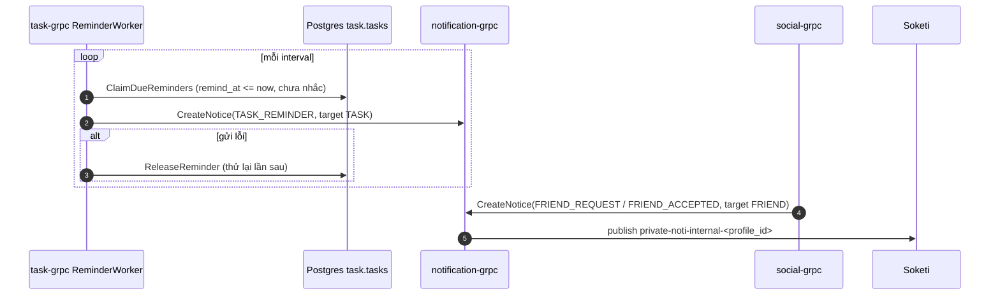

# 02 — Sơ đồ kiến trúc hệ thống

> Toàn bộ sơ đồ là **Mermaid**. Xem trực tiếp trên GitHub / VS Code (extension *Markdown Preview
> Mermaid Support*) / <https://mermaid.live>.

## 1. Kiến trúc triển khai (Docker Compose)

Chỉ container `frontend` (nginx) được publish ra host (`127.0.0.1:3000`). Mọi API đi qua

```mermaid
flowchart TB
    classDef edge fill:#e0e7ff,stroke:#4f46e5,color:#1e1b4b
    classDef gw fill:#ecfeff,stroke:#0891b2,color:#164e63
    classDef grpc fill:#dcfce7,stroke:#16a34a,color:#14532d
    classDef infra fill:#fef3c7,stroke:#d97706,color:#78350f
    classDef ext fill:#fce7f3,stroke:#db2777,color:#831843

    Browser["Browser (SPA)"]
    CF["cloudflared<br/>(profile tunnel)"]:::edge
    NGINX["frontend: nginx :80<br/>host 127.0.0.1:3000<br/>static SPA + reverse proxy /api/*"]:::edge

    Browser -->|HTTPS| CF --> NGINX
    Browser -->|"http://localhost:3000"| NGINX

    subgraph GW["HTTP gateways (grpc-gateway + route viết tay)"]
        idh["identity :8081"]:::gw
        tah["task :8082"]:::gw
        cah["calendar :8083"]:::gw
        mah["mail-provider :8084"]:::gw
        evh["event :8085"]:::gw
        bah["backlog :8086"]:::gw
        reh["report :8087"]:::gw
        noh["notification :8088"]:::gw
        ath["attachment :8089"]:::gw
        prh["project :8090"]:::gw
        soh["social :8091"]:::gw
        meh["message :8092"]:::gw
    end

    NGINX -->|/api/identity/| idh
    NGINX -->|/api/task/| tah
    NGINX -->|/api/calendar/| cah
    NGINX -->|/api/mail/| mah
    NGINX -->|/api/event/| evh
    NGINX -->|/api/backlog/| bah
    NGINX -->|/api/report/| reh
    NGINX -->|/api/notification/| noh
    NGINX -->|/api/attachment/| ath
    NGINX -->|/api/project/| prh
    NGINX -->|/api/social/| soh
    NGINX -->|/api/message/| meh
    NGINX -->|"/api/soketi/ (WebSocket)"| SOK

    subgraph GR["gRPC servers (nghiệp vụ)"]
        idg["identity-grpc :9081"]:::grpc
        tag["task-grpc :9082"]:::grpc
        cag["calendar-grpc :9083"]:::grpc
        mag["mail-provider-grpc :9084"]:::grpc
        evg["event-grpc :9085"]:::grpc
        bag["backlog-grpc :9086"]:::grpc
        reg["report-grpc :9087"]:::grpc
        nog["notification-grpc :9088"]:::grpc
        atg["attachment-grpc :9089"]:::grpc
        prg["project-grpc :9090"]:::grpc
        sog["social-grpc :9091"]:::grpc
        meg["message-grpc :9092"]:::grpc
        wrk["worker xN<br/>(health :8094)"]:::grpc
    end

    idh --> idg
    tah --> tag
    cah --> cag
    mah --> mag
    evh --> evg
    bah --> bag
    reh --> reg
    noh --> nog
    ath --> atg
    prh --> prg
    soh --> sog
    meh --> meg

    PG[("postgres :5432<br/>DB task_manager")]:::infra
    MIG["migrate (job)"]:::infra
    S3[("rustfs :9000<br/>bucket task-manager")]:::infra
    KAFKA[["kafka :9092<br/>chat.messages x6 partition"]]:::infra
    SOK{{"soketi :6001"}}:::infra

    MIG --> PG
    idg & tag & cag & mag & evg & bag & nog & atg & prg & sog & meg & wrk --> PG
    atg & mag --> S3
    meg --> KAFKA --> wrk
    nog & meg --> SOK

    GOOG["Google OAuth / OIDC"]:::ext
    GMAIL["Gmail API"]:::ext
    PUBSUB["Google Cloud Pub/Sub"]:::ext
    DS["DeepSeek API"]:::ext

    idh --> GOOG
    mag --> GMAIL & DS & PUBSUB
    mag --> GOOG
    PUBSUB -->|"push: POST /api/mail/v1/notifications"| CF
```

`/api/<service>/...` và được nginx forward nội bộ tới gateway HTTP của service. Mỗi service
chạy **2 container**: `<svc>` (grpc-gateway, HTTP) và `<svc>-grpc` (gRPC server, nghiệp vụ).

## 2. Kiến trúc logic (các lớp)

## 3. Xác thực & phân quyền

- Session token: **JWT HS256**, khoá `SESSION_SECRET` dùng chung giữa `identity`, `notification`,
  `social`, `message` (các gateway này tự verify token và lấy `profile_id` từ claim `sub`).
- Các gateway `task`, `project`, `calendar`, `event`, `backlog`, `attachment`, `report` hiện nhận
  `profile_id` từ query/body của client (chưa verify token ở gateway).
- Kênh realtime private: `private-noti-internal-<profile_id>` và `private-chat-<profile_id>`;
  chữ ký subscribe do `identity` cấp tại `POST /v1/auth/soketi`, chỉ cho đúng chủ kênh.

## 4. Luồng chính (sequence)

### 4.1 Kéo thả task đổi trạng thái (lifecycle)

### 4.2 Email Gmail → task / lịch / sự kiện / backlog

### 4.3 Nhắn tin realtime + lưu bất đồng bộ

### 4.4 Nhắc việc (reminder) và thông báo bạn bè

## 5. Quyết định kiến trúc chính

| Quyết định | Lý do / hệ quả |
|---|---|
| Microservice, **1 service = 1 Go module** | Build/deploy độc lập; dùng `go.work` khi dev |
| **gRPC nội bộ + grpc-gateway** ra ngoài | Interface khai báo 1 lần trong proto; REST tự sinh |
| **Schema-per-service** trên 1 Postgres | Ranh giới dữ liệu rõ, vận hành đơn giản; ràng buộc chéo qua gRPC |
| Fallback **in-memory** khi thiếu `DATABASE_URL` | Chạy local/test không cần DB |
| **Kafka + worker** cho chat | Realtime trước (Soketi), lưu sau; scale ngang worker theo partition |
| **Soketi** (Pusher protocol) | Push realtime notice + chat; kênh private ký bởi identity |
| **RustFS** thay MinIO | MinIO OSS bị archive; vẫn dùng SDK `minio-go` (S3 API) |
| Bộ **mã lỗi chuẩn** (`common/errorcode`) | FE dịch `reason` thành message vi/en, không lộ lỗi kỹ thuật |
| Best-effort cho side effect (seed, notice, soketi) | Lỗi phụ chỉ log, không làm hỏng thao tác chính |
| **Không dùng Redis** | Không có cache phân tán; state tạm nằm trong RAM của từng process |
