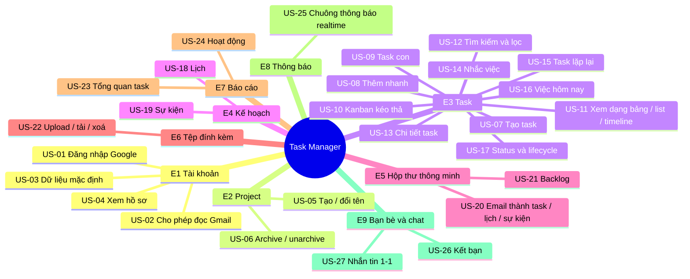

# 04 — User story

Định dạng: **Là** `<vai trò>`, **tôi muốn** `<hành động>` **để** `<giá trị>`.
Mỗi story kèm tiêu chí chấp nhận (AC) rút ra từ hành vi thực tế trong code và service liên quan.

Vai trò:

- **Người dùng** — người dùng cá nhân đã đăng nhập.
- **Khách** — chưa đăng nhập.
- **Hệ thống** — tác nhân tự động (mail worker, reminder worker, Kafka worker).

## Bản đồ epic

---

## E1 — Tài khoản

### US-01 · Đăng nhập bằng Google
**Là** khách, **tôi muốn** đăng nhập bằng tài khoản Google **để** không phải tạo mật khẩu riêng.

- AC1: Bấm "Đăng nhập với Google" ⇒ chuyển sang Google, quay về `/auth/callback` và vào ứng dụng.
- AC2: Lần đầu đăng nhập ⇒ tạo profile mới từ email/tên Google; lần sau ⇒ dùng lại profile cũ.
- AC3: Phiên đăng nhập là session token (JWT), mặc định 30 ngày; `GET /v1/auth/me` trả hồ sơ.
- AC4: Lỗi (chưa cấu hình, đổi code thất bại) ⇒ hiển thị message thân thiện theo mã lỗi.
- Service: `identity` (HTTP + gRPC), Google OAuth.

### US-02 · Cho phép đọc Gmail
**Là** người dùng, **tôi muốn** tích "Cho phép đọc Gmail" khi đăng nhập **để** email mới được tự
động biến thành việc / lịch / sự kiện.

- AC1: Tích ô ⇒ Google hỏi thêm quyền `gmail.readonly`.
- AC2: Sau đăng nhập, hệ thống đăng ký watch Gmail (`mail-provider.Subscribe`) và tự gia hạn trước
  khi hết hạn 7 ngày.
- AC3: Đăng ký lỗi không chặn đăng nhập (chỉ log).
- Service: `identity` → `mail-provider` → Gmail.

### US-03 · Có sẵn dữ liệu mặc định
**Là** người dùng mới, **tôi muốn** có sẵn bộ trạng thái và project mặc định **để** dùng ngay mà
không phải cấu hình.

- AC1: Profile mới có 4 status (To Do, On Progress, In Review, Completed) + 5 rule chuyển và
  project `Chung`.
- AC2: Nếu seed thất bại, board có nút "Tạo bộ status mặc định" (`POST /v1/statuses/seed`,
  idempotent).
- Service: `identity` → `task`, `project`.

### US-04 · Xem hồ sơ
**Là** người dùng, **tôi muốn** thấy tên và avatar của mình trên topbar **để** biết đang dùng tài khoản nào.

---

## E2 — Project

### US-05 · Tạo / đổi tên project
**Là** người dùng, **tôi muốn** chia công việc theo project **để** tách các mảng (đồ án, cá nhân, ...).

- AC1: Tên bắt buộc, không trùng trong profile (không phân biệt hoa thường).
- AC2: Task / lịch / sự kiện luôn thuộc 1 project; mặc định là `Chung`.
- AC3: Lọc board / lịch / sự kiện / báo cáo theo project.

### US-06 · Archive / unarchive project
**Là** người dùng, **tôi muốn** lưu trữ project đã xong **để** danh sách gọn hơn.

- AC1: Không archive được project `Chung`.
- AC2: Project đã archive không sửa được và không gán thêm task / lịch / sự kiện mới.
- AC3: Unarchive khôi phục bình thường.

---

## E3 — Task

### US-07 · Tạo task
**Là** người dùng, **tôi muốn** tạo task với tiêu đề, mô tả, ưu tiên, ngày bắt đầu, hạn **để**
theo dõi việc cần làm.

- AC1: Tiêu đề bắt buộc (`TASK_TITLE_REQUIRED`).
- AC2: Không chọn status ⇒ dùng status mặc định (cột đầu).
- AC3: Ưu tiên: thấp / trung bình / cao / khẩn.

### US-08 · Thêm nhanh bằng 1 dòng
**Là** người dùng, **tôi muốn** gõ `Nộp báo cáo mai 9h !cao #đồ-án` **để** tạo task nhanh có sẵn
hạn, ưu tiên, project.

- AC1: Nhận ngày / giờ / ưu tiên / project ở ranh giới từ; lấy lần xuất hiện cuối.
- AC2: Chỉ có giờ ⇒ hôm nay (đã qua thì ngày mai); bọc `"..."` để giữ nguyên văn.

### US-09 · Task con
**Là** người dùng, **tôi muốn** chia task lớn thành task con **để** theo dõi tiến độ chi tiết.

- AC1: Card hiển thị tiến độ `done/total` theo task con có status DONE.
- AC2: Task con luôn cùng project với cha; đổi project task cha ⇒ cả cây đổi theo.
- AC3: Không tạo vòng lặp cha-con; không xoá task còn task con.

### US-10 · Kanban kéo thả
**Là** người dùng, **tôi muốn** kéo card sang cột khác **để** đổi trạng thái nhanh.

- AC1: Cột = status của profile theo `position`, có màu riêng.
- AC2: Kéo thả gọi `POST /v1/tasks/{id}/status`; nếu không có rule chuyển ⇒ thông báo đỏ, card quay lại.
- AC3: Sang status DONE ⇒ ghi `completed_at`; mọi lần đổi được ghi lịch sử.

### US-11 · Nhiều chế độ xem
**Là** người dùng, **tôi muốn** xem task dạng Kanban / Bảng / List / Timeline **để** chọn cách nhìn
phù hợp.

### US-12 · Tìm kiếm và lọc
**Là** người dùng, **tôi muốn** tìm theo từ khoá và lọc theo status / ưu tiên / hạn / project **để**
nhanh chóng thấy việc cần.

- AC1: Tìm kiếm full-text phía server (`query`), có phân trang.

### US-13 · Chi tiết task
**Là** người dùng, **tôi muốn** bấm vào task để xem mô tả, trạng thái, ưu tiên, các mốc thời gian,
tiến độ, task cha / con và tệp đính kèm.

- AC1: Mở từ card, dòng bảng, hoặc từ thông báo (`?focus=<task_id>`).

### US-14 · Nhắc việc
**Là** người dùng, **tôi muốn** đặt thời điểm nhắc cho task **để** không quên việc quan trọng.

- AC1: Đến `remind_at` ⇒ nhận thông báo "Nhắc việc: <tiêu đề>" realtime.
- AC2: Mỗi lần nhắc chỉ gửi 1 lần; gửi lỗi ⇒ hệ thống thử lại.
- AC3: Có thể xoá nhắc (`clear_remind_at`).

### US-15 · Task lặp lại
**Là** người dùng, **tôi muốn** đặt task lặp (hằng ngày / tuần / ...) **để** không phải tạo lại thủ công.

- AC1: Hoàn thành 1 lần lặp ⇒ tự tạo lần kế tiếp với hạn mới.
- AC2: Mở lại rồi hoàn thành lại không sinh trùng.
- AC3: Báo cáo đếm mỗi lần lặp là 1 task.

### US-16 · Việc hôm nay
**Là** người dùng, **tôi muốn** một trang "Hôm nay" liệt kê việc đến hạn / quá hạn **để** tập trung
vào việc cần làm ngay và đổi trạng thái tại chỗ.

### US-17 · Tuỳ biến status & lifecycle
**Là** người dùng, **tôi muốn** tạo / sửa / xoá status và rule chuyển **để** quy trình khớp cách
mình làm việc.

- AC1: Không xoá status đang được task dùng.
- AC2: Chỉ 1 status mặc định; không tạo rule trùng hoặc `from = to`.
- Ghi chú: trang `/statuses` hiện đã ẩn khỏi menu điều hướng.

---

## E4 — Kế hoạch

### US-18 · Lịch cá nhân
**Là** người dùng, **tôi muốn** xem và quản lý lịch trên giao diện calendar **để** sắp xếp thời gian.

- AC1: Hiển thị ngày / tuần / tháng (FullCalendar), chỉ tải đúng khoảng đang xem.
- AC2: Tạo / sửa / xoá lịch, hỗ trợ cả ngày (all-day) và màu.
- AC3: Giờ kết thúc không được sớm hơn giờ bắt đầu.

### US-19 · Sự kiện
**Là** người dùng, **tôi muốn** quản lý sự kiện có trạng thái dự kiến / đã xác nhận / đã huỷ **để**
phân biệt sự kiện cần xác nhận với lịch thường.

- AC1: Lọc theo khoảng thời gian và trạng thái.
- AC2: Sự kiện tạo từ email có `source` để truy vết.

---

## E5 — Hộp thư thông minh

### US-20 · Email tự thành task / lịch / sự kiện
**Là** người dùng đã bật đọc Gmail, **tôi muốn** email mới được phân loại tự động **để** không phải
chép tay việc từ hộp thư.

- AC1: Email yêu cầu hành động ⇒ task; cuộc hẹn ⇒ lịch; thư mời / hội thảo ⇒ sự kiện.
- AC2: Có thông báo realtime sau khi tạo.
- AC3: AI lỗi / không có ⇒ dùng rule từ khoá dự phòng.
- AC4: Email gốc + tệp đính kèm được lưu lại.
- Tác nhân: **Hệ thống** (`mail-provider`).

### US-21 · Backlog email
**Là** người dùng, **tôi muốn** xem các email không phân loại được **để** tự xử lý, không bỏ sót.

- AC1: Mỗi mục có tiêu đề, người gửi, lý do (`reason`), category.
- AC2: Chuyển trạng thái NEW → TRIAGED → ARCHIVED; lọc theo status / category.
- AC3: Sửa / xoá; đính kèm tệp.

---

## E6 — Tệp đính kèm

### US-22 · Đính kèm tệp
**Là** người dùng, **tôi muốn** đính kèm tệp vào task / lịch / sự kiện / backlog **để** giữ tài liệu
liên quan một chỗ.

- AC1: Upload (≤ 10 MiB mặc định), tải xuống đúng tên tệp, xoá.
- AC2: Danh sách tệp theo đối tượng sở hữu.

---

## E7 — Báo cáo

### US-23 · Báo cáo task
**Là** người dùng, **tôi muốn** xem tổng quan, tỉ lệ theo trạng thái và biểu đồ tạo / hoàn thành
theo thời gian **để** đánh giá năng suất.

- AC1: Chọn khoảng thời gian (mặc định 30 ngày) và bucket ngày / tuần / tháng.
- AC2: Hiển thị tỉ lệ hoàn thành, quá hạn, sắp đến hạn.

### US-24 · Báo cáo hoạt động
**Là** người dùng, **tôi muốn** thống kê lịch, sự kiện và backlog **để** thấy toàn cảnh kế hoạch.

---

## E8 — Thông báo

### US-25 · Chuông thông báo realtime
**Là** người dùng, **tôi muốn** thấy số thông báo chưa đọc cập nhật tức thì **để** không bỏ lỡ việc mới.

- AC1: Badge cập nhật khi có notice mới (WebSocket) mà không cần tải lại trang.
- AC2: Bấm notice ⇒ mở đúng đối tượng và đánh dấu đã đọc; có "đánh dấu tất cả".
- AC3: Chỉ thấy notice của chính mình.

---

## E9 — Bạn bè & chat

### US-26 · Kết bạn
**Là** người dùng, **tôi muốn** tìm bạn theo email và gửi lời mời **để** có thể nhắn tin.

- AC1: Gửi / huỷ lời mời; người nhận chấp nhận / từ chối; huỷ kết bạn.
- AC2: Bên kia nhận thông báo khi có lời mời / được chấp nhận.
- AC3: Không tự kết bạn với chính mình; mỗi cặp chỉ 1 quan hệ.

### US-27 · Nhắn tin 1-1
**Là** người dùng, **tôi muốn** nhắn tin realtime với bạn bè **để** trao đổi nhanh.

- AC1: Chỉ nhắn được với bạn bè; tin 1..2000 ký tự.
- AC2: Tin hiện ngay ở người nhận và mọi tab của người gửi.
- AC3: Danh sách cuộc trò chuyện kèm tin cuối; cuộn lên để tải tin cũ hơn.
- AC4: Tin được lưu bền vững (Kafka → worker → Postgres), không trùng khi xử lý lại.

---

## Story kỹ thuật (hệ thống)

| ID | Story | Service |
|---|---|---|
| TS-01 | Là hệ thống, tôi muốn gia hạn watch Gmail trước khi hết hạn để không mất email | mail-provider |
| TS-02 | Là hệ thống, tôi muốn xử lý notice Pub/Sub idempotent theo checkpoint `historyId` | mail-provider |
| TS-03 | Là hệ thống, tôi muốn scale số worker theo số partition Kafka khi tải chat tăng | worker |
| TS-04 | Là hệ thống, tôi muốn mọi lỗi trả mã chuẩn để FE dịch vi/en | tất cả |
| TS-05 | Là dev, tôi muốn chạy service không cần Postgres (in-memory) để test nhanh | tất cả |
