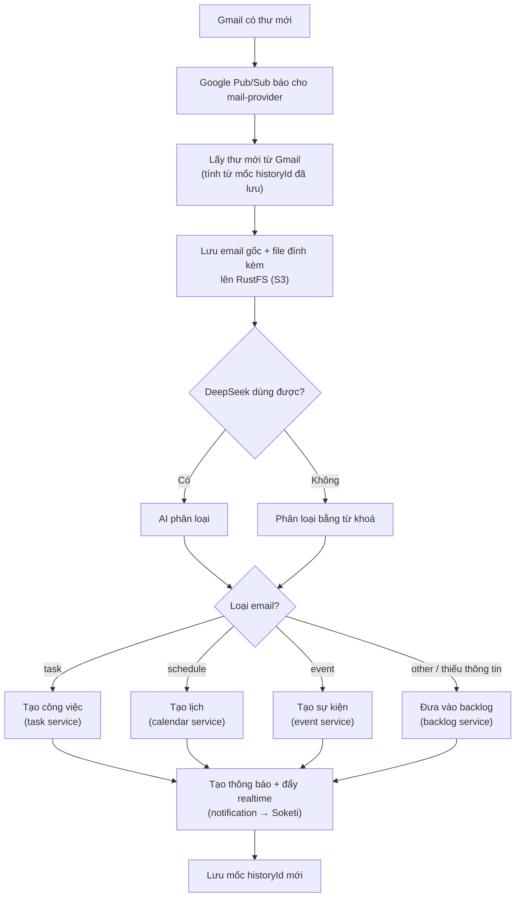

# 06 — Luồng xử lý mail (đơn giản)

Luồng tự động biến email Gmail thành công việc / lịch / sự kiện / backlog.
Chi tiết từng bước gọi API: [02-architecture.md §4.2](02-architecture.md),
[05-service-calls-and-data.md §5.2](05-service-calls-and-data.md),
`service/mail-provider/README.md`.

**Ghi nhớ nhanh**

- Không email nào bị mất: phân loại không chắc hoặc thiếu dữ kiện (ví dụ lịch không có giờ) đều vào **backlog** kèm lý do.
- AI lỗi hoặc không có `DEEPSEEK_API_KEY` thì tự chuyển sang **luật từ khoá**.
- Chỉ lưu mốc `historyId` mới **sau khi xử lý xong**, nên thông báo trùng hoặc đến sai thứ tự vẫn không làm mất thư.
